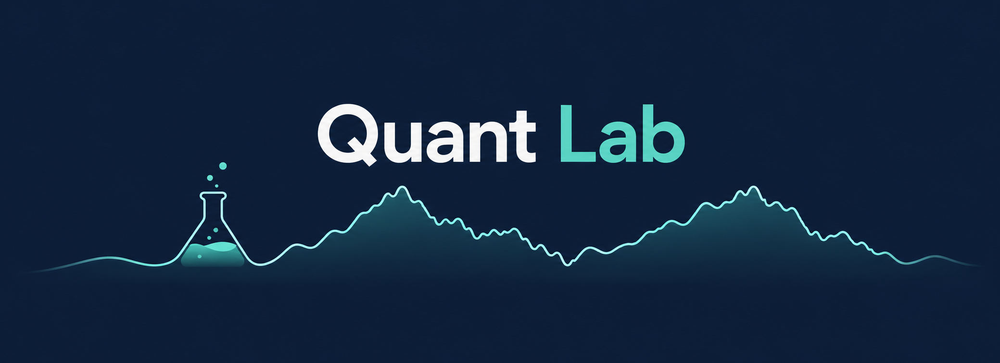

# Quant Lab

<p align="center">
  
</p>


Quant Lab is an **AI-assisted systematic trading learning environment, research laboratory and trading-control platform**. The repository grows from first principles into a tested system that progresses from research to Interactive Brokers paper trading and, only after explicit validation, live execution.

The project has two equally important outcomes:

1. **Understanding** — learn systematic strategies, mathematics/statistics, evidence, assumptions and failure modes.
2. **Engineering** — turn that understanding into a reusable Python platform with a modern web interface.

Backtest performance is not evidence of future returns. Quant Lab is designed to make it difficult to fool ourselves.

## V1 external integrations: exactly two

For the initial project scope we deliberately support only two external financial-platform connectors:

### Interactive Brokers (IBKR)
The **broker and execution connector**, and also a market/account-data source when appropriate.

Planned responsibilities:
- market-data access where the account/subscriptions permit it;
- paper account state;
- paper orders/fills/positions;
- later live account observation;
- only after explicit promotion, controlled live execution.

IBKR-specific SDK/API objects remain behind adapters; strategies never depend on IBKR.

### QuantConnect
The **research/data/backtesting connector**.

Planned responsibilities:
- historical/research data access where supported;
- independent research/backtest comparison;
- educational reproduction/comparison of strategies;
- a second data source behind the same normalized Quant Lab data interfaces.

QuantConnect is not the v1 execution broker. **IBKR is the only planned execution broker.**

No Twelve Data, Alpha Vantage, Yahoo Finance or additional market-data provider is part of v1. New providers can be proposed later behind the same interfaces without redesigning strategies.

## Product vision: progressive tabs

The application has five conceptual tabs, but they are **unlocked by learning milestones**. We do not build empty operational screens before the course has created the capabilities behind them.

### 1. Learn — available first
The spine of the product:
- ordered lessons from market/data basics to advanced statistical/ML strategies;
- intuition, mathematics, evidence and implementation;
- examples/visualizations using historical data;
- exercises, quizzes and coding tasks;
- progress;
- paper/reference links;
- experiment/backtest results;
- AI tutor;
- links from lessons to the code/PRs they created.

### 2. Market — unlocked progressively; observation only
Historical observation appears early; real-time observation is unlocked only after real-time-data lessons/connectors are implemented.
- watchlists/instruments;
- price/return charts and OHLCV;
- selected features/signals;
- timestamps/session/data-source status.

This tab **cannot place orders**.

### 3. Paper Trading — locked until execution + IBKR paper integration
- paper account equity/cash;
- positions, orders and fills;
- realized/unrealized P&L;
- performance per asset, bot/strategy and total;
- historical equity/P&L;
- execution/reconciliation diagnostics.

### 4. Live Trading — locked until paper validation
Initially observation-only. Any future live-order capability is a separate, explicitly gated milestone with risk controls and kill switches.

### 5. Strategies / Control — catalogue first, controls later
Strategy knowledge can appear as strategies are learned. Runtime controls unlock only when bots exist:
- strategy hypothesis/rules/evidence/version;
- bot active/inactive/health state;
- universe/assets;
- P&L by bot, asset and aggregate;
- exposure/risk;
- activate/deactivate/stop;
- global automated-trading kill switch.

A **strategy** is reusable logic; a **bot** is a running strategy configuration/environment/universe.

## Technology

- **Python:** quantitative domain, research, data, strategies, backtesting, portfolio/risk, execution, connectors and API.
- **FastAPI:** leading application/API candidate once required.
- **TypeScript + React:** modern web UI; framework/tooling chosen when Learn UI implementation requires it.
- **Jupyter:** exploratory research, with reusable logic moved into the Python package.
- **pytest:** automated correctness tests.

## System shape

```text
             +----------- progressively unlocked UI -----------+
             | Learn | Market | Paper | Live | Strategies      |
             +-----------------------+--------------------------+
                                     |
                                  Python API
                                     |
 +-------------------------- Quant Lab ---------------------------+
 | Data -> Features -> Strategies -> Portfolio -> Risk -> Execution|
 |   |                       |             |             |         |
 | Research/Backtest         +------ Attribution          |         |
 +---+---------------------------------------------------+---------+
     |                                                   |
 MarketData/Research interfaces                     Broker interface
     |                                                   |
 +---+----------------+                                  |
 |                    |                                  |
IBKR              QuantConnect                          IBKR
market/account    research/data                 paper -> later live
```

The rest of Quant Lab consumes **normalized internal models**, not vendor-specific objects.

Research may use fast vectorized/batched computation, but strategies promoted toward paper/live must preserve the same canonical clock/event/order semantics. Experiments carry data lineage and reproducible configuration, and comparable results converge on standard tear sheets rather than isolated headline returns.

## Learning philosophy

```text
question -> intuition -> mathematics -> evidence
 -> worked example -> hypothesis -> implementation
 -> tests -> backtest/experiment -> interpretation
 -> failure modes -> challenge -> capability unlocked
```

AI roles:
- **ChatGPT:** tutor, research synthesizer, quant critic and examiner.
- **Codex:** implementation agent working from explicit lesson/issue specifications.
- **GitHub:** source of truth for lessons, references, decisions, experiments and code.
- **Learner:** architect/researcher responsible for understanding assumptions and evidence.

See [ROADMAP.md](ROADMAP.md), [ARCHITECTURE.md](ARCHITECTURE.md), [course/README.md](course/README.md) and [REFERENCES.md](REFERENCES.md).

## Repository direction

The target structure separates **domain**, **research**, **runtime** and **infrastructure** so external vendors never become the architecture:

```text
quant-lab/
├── course/
├── notebooks/
├── experiments/
├── src/quant_lab/
│   ├── domain/          # instruments, market data, signals, orders, events
│   ├── research/        # features, statistics, backtesting, experiments
│   ├── strategies/
│   ├── risk/
│   ├── attribution/
│   ├── runtime/         # bots and clock abstractions
│   ├── application/
│   └── infrastructure/  # IBKR, QuantConnect, persistence, telemetry
├── api/
├── frontend/
├── tests/               # unit, integration, contract, e2e as needed
└── docs/
```

This is a **target architecture, not initial scaffolding**. Components/directories are introduced only when a lesson creates a real requirement. See [ARCHITECTURE.md](ARCHITECTURE.md) for canonical instruments, clocks, events, configuration/versioning, experiment identity, persistence, bot/run identity, audit, observability and the testing model.

## Non-negotiables

- no look-ahead/future leakage;
- explicit timestamps/timezones/decision timing;
- realistic costs before performance claims;
- chronological validation;
- risk reported with return;
- strategies independent from vendors/brokers;
- vendor data normalized at connector boundaries;
- P&L attributable by bot/strategy and asset;
- paper before live;
- paper/live visibly and technically separated;
- per-bot stop controls + global kill switch;
- live orders disabled by default.

## First implementation

**Lesson 1 — Market Data, Returns & Research Environment** is the first coding milestone.

It establishes the Python package/tests, canonical OHLCV/time models, simple/log returns, validation and a **provider abstraction designed for the two v1 connectors: IBKR and QuantConnect**. The lesson does not need to fully integrate both external APIs immediately; it establishes the contract they will later implement.

The **Learn** application contains five interactive Lesson 1 chapters: bar timing, return measurement, a backtest audit, explained knowledge checks, and evidence. It includes deterministic Python-generated experiments with explicit costs and a deliberately future-informed comparison. Other tabs unlock only when their prerequisites exist.


## Run Lesson 1

Python research/tests:

```bash
python -m venv .venv
# activate the environment, then:
pip install -e ".[dev]"
pytest
python -m quant_lab.research.lesson_one --check
```

Learn UI:

```bash
cd frontend
npm install
npm run dev
```

Lesson content: [course/lesson-01-market-data-returns.md](course/lesson-01-market-data-returns.md).

Worked experiments, regeneration instructions and answer rubric: [Lesson 1 lab guide](course/lesson-01-lab-guide.md). Source decisions and the LEAN trace: [implementation review](course/lesson-01-source-review.md).

At this milestone the **Learn** surface and deterministic historical-data visualization are available. Market real-time, IBKR/QuantConnect connectivity, Paper Trading, Live Trading and runtime controls remain locked until their roadmap prerequisites are implemented.
