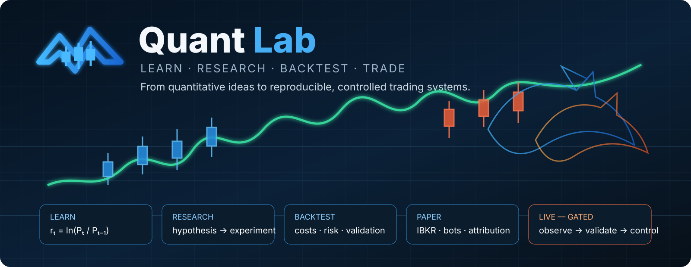

# Quant Lab Interactive Course

  

The **Learn** tab is the primary product surface during the first stages of Quant Lab. Markdown files are the version-controlled source of truth, but the application will progressively render them as an interactive course connected to code and experiments.

## Learning model

A lesson answers four questions in order:

1. **What is the problem?**
2. **What mathematical/statistical idea addresses it?**
3. **What evidence suggests the idea may matter in markets?**
4. **Can we implement and test it without fooling ourselves?**

## Standard lesson contract

1. Why this exists
2. Prerequisites
3. Intuition
4. Mathematics/statistics
5. Worked example with checkable numbers
6. Evidence and selected papers
7. Trading/research hypothesis
8. Exact decision-time information
9. Implementation specification
10. Tests
11. Experiment/backtest
12. Costs and benchmark
13. Interpretation
14. Failure modes / invalidation
15. Challenge/quiz
16. Learning outcomes
17. Platform capability unlocked

## Interactive Learn tab

The UI should eventually show:
- course tree and prerequisite graph;
- current lesson and completion state;
- formatted equations and diagrams;
- interactive charts/examples;
- “paper/evidence” cards linking to primary sources;
- coding task/specification;
- experiment result panels;
- quizzes/challenges;
- AI tutor conversation scoped to the lesson;
- links to the implementation/PR produced by the lesson.

A lesson is not complete because the user clicked “next”; completion should mean the learner has performed the implementation/experiment and can answer the core challenge.

## Research sourcing policy

Course material should prefer:
1. peer-reviewed papers / canonical working papers;
2. official exchange/broker/API documentation;
3. reputable quantitative research/educational material;
4. videos/blogs only where they add a particularly useful explanation or visualization.

Multiple sources are synthesized into one lesson. We do not duplicate five RSI explanations because five videos discuss RSI.

See `REFERENCES.md` for initial anchors.

## AI workflow

**ChatGPT** teaches, synthesizes references, asks questions and critiques experiments.  
**Codex** implements explicit specifications in VS Code.  
**GitHub** stores lesson source, implementation and review history.  
**The learner** must understand/defend assumptions and interpret results.

LLMs do not receive authority to bypass risk controls or directly decide live orders.

## First three lessons

### Lesson 1 — Market Data, Returns & Research Environment
OHLCV, timestamps/timezones, adjusted prices, simple/log returns, data quality and Python research setup.

**Unlocks:** canonical data layer + first historical visualization in Learn.

### Lesson 2 — Statistics and Performance
Compounding, volatility, covariance/correlation, drawdown, CAGR and risk-adjusted metrics.

**Unlocks:** metrics library and result cards.

### Lesson 3 — Backtesting Mechanics
Decision timing, lags, orders/fills, costs, spread/slippage, warm-up and common biases.

**Unlocks:** minimal backtest contract and benchmark experiment.

Only after these foundations do we evaluate the first strategy family.

## Strategy learning order

Trend/momentum -> breakout -> mean reversion -> relative value/pairs -> cointegration -> factors/portfolios -> advanced stat-arb -> regimes/ML -> strategy allocation.

This ordering moves from simple observable price transformations to statistical relationships, then multivariate/adaptive models, while the validation framework grows alongside them.
